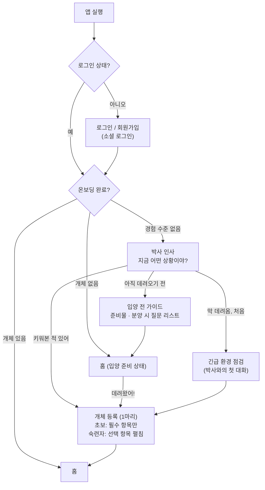
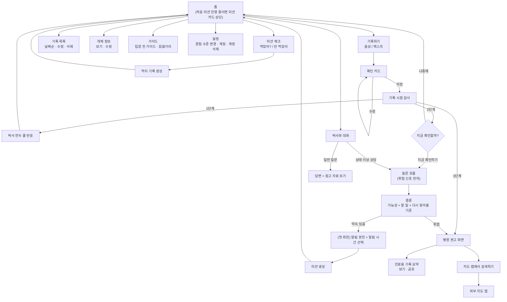
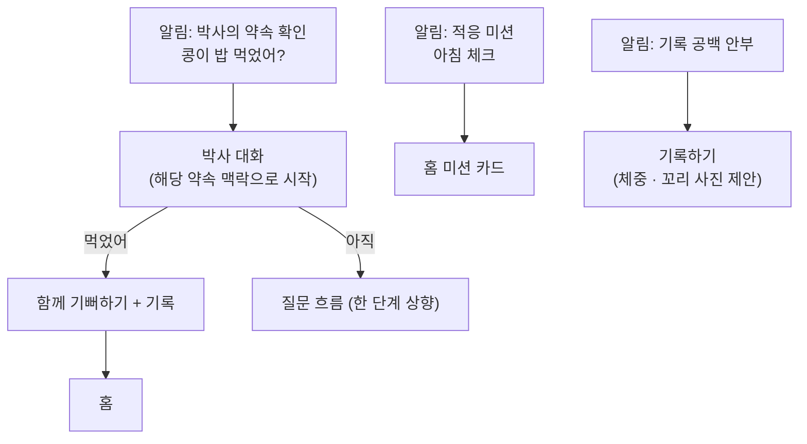

# 08. User Flow

> 상태: 확정 (2026-10-07), V0 알파 범위 반영 (2026-10-18)
> 근거 문서: 01 ~ 07
> 다음 단계: 화면 목록

앱을 세 덩어리로 나눠서 그린다.

1. **첫 실행 플로우**: 앱을 처음 열어서 홈에 도착할 때까지
2. **홈 플로우**: 홈에서 기록, 박사 대화, 미션, 설정 등으로 뻗어나감
3. **외부 진입 플로우**: 알림을 눌러 들어올 때

---

## 1. 첫 실행 플로우 (V0 알파, 2026-10-18 변경)

> V0는 알파 테스트라 **로그인해야 앱을 쓸 수 있다.** 비회원 사용, 익명 로그인은 V0에서 사용하지 않는다. (정식 출시 검토안은 이 섹션 아래)



### 앱을 열 때의 이동 규칙

| 상태                                | 이동                                             |
| ----------------------------------- | ------------------------------------------------ |
| 로그인 안 됨                        | 로그인 / 회원가입                                |
| 로그인 + 경험 수준 없음             | 박사 인사 (3갈래)                                |
| 로그인 + 경험 수준 있음 + 개체 없음 | 홈 (입양 준비 상태: 입양 전 가이드, [데려왔어!]) |
| 로그인 + 개체 있음                  | 홈                                               |

### 알파에서 받아들이는 것

- 1B(막 데려온 초보)도 **로그인 후** 긴급 점검을 하게 됨 → 소셜 로그인(애플·구글·카카오 등)으로 가입 단계를 최소화
- 알파 테스터는 모집된 사람들이라 첫 진입 장벽의 영향이 작음
- 개체는 **1마리 고정** → 등록 후 "개체 추가" 진입점 없음

> 확장 대비: 정식 출시 때 "계정 없이 시작"(Supabase 익명 로그인)을 검토. 근거는 11 벤치마킹.

---

## 2. 홈 플로우 (확정)



### 재사용되는 화면 (컴포넌트로 설계)

| 화면               | 들어오는 곳                                           |
| ------------------ | ----------------------------------------------------- |
| **질문 흐름**      | 1B 긴급 환경 점검, 기록 후 2단계, 박사 상태 이상 상담 |
| **병원 권고 화면** | 기록 후 3단계, 박사 상담 결론(위험)                   |

### 이 단계에서 추가된 기능

- **기록 목록 (날짜순 + 수정·삭제)** — Must
  잘못된 기록은 박사 판단과 이상 감지 규칙을 오염시킴 (예: "묽음" 중복 저장 → 잘못된 2단계 경고)
- **개체 정보 보기·수정** — Must (다른 서비스의 프로필 수정에 해당)

---

## 기록 방식: 사용자 주도 vs 박사 주도

> **2026-10-07 변경**: 알림은 로컬 알림이 아닌 **서버 푸시**로 구현 (10 DB 구조 참고). 아래의 "로컬 알림 예약·재예약", `notification_id`, "예약된 알림 취소"는 당시 기준이며, 서버 푸시에서는 발송 직전 DB 상태 확인으로 대체됨.

**기본은 사용자 주도.** 일이 생긴 순간에 남기는 기록이 가장 정확하다.
**박사 주도는 "상황이 있을 때만".** 고정 주기로 매일 묻지 않는다.

| 방식                      | 언제                                    | 분류       |
| ------------------------- | --------------------------------------- | ---------- |
| 사용자 주도 기록          | 언제든                                  | Must       |
| 미션 체크                 | 적응 미션 기간                          | Must       |
| 박사의 약속 확인          | 상담 후 약속했을 때                     | Must       |
| **기록 공백 안부**        | 기록이 N일 이상 끊겼을 때               | **Should** |
| **알림 시간 선택**        | 알림 권한 요청 시 "보통 몇 시쯤 밥 줘?" | **Should** |
| 정기 체크 (예: 매주 체중) | 설정에서 원하는 사람만 켬               | Later      |

### 기록 공백 안부

> 🔔 "콩이 요즘 잘 지내? 오랜만에 체중이랑 꼬리 사진 한번 남겨볼까?"

- 목적: 익숙해진 사용자의 **기준선 유지** (문제 발생 시 비교할 최근 기록 확보)
- 구현: 기록 저장 시마다 "N일 뒤 안부" 로컬 알림을 **다시 예약** (기존 예약 취소 후 재예약)
  → 꾸준히 기록하는 사람에겐 알림이 가지 않고, 끊긴 사람에게만 감
  → 복잡한 트리거 관리 불필요

### 썸원(SumOne) 참고

- 유사점: 정해진 시간에 질문 → 가볍게 답 → 캐릭터(반려몽) 성장, 사용자가 질문 시간 설정
- 차이점: 썸원은 **매일 여는 것 자체가 가치**. 우리는 **매일 쓰게 강요하지 않음**
- 빌려온 것: **사용자가 시간을 정하게 하기** → 알림 시간 선택
- 보류한 것: 기록이 쌓이면 무언가 자라는 재미 요소 → 정서적 가치 영역이라 Later

---

## 3. 외부 진입 플로우 (확정)

> **2026-10-07 변경**: 알림은 로컬 알림이 아닌 **서버 푸시**로 구현 (10 DB 구조 참고). 아래의 "로컬 알림 예약·재예약", `notification_id`, "예약된 알림 취소"는 당시 기준이며, 서버 푸시에서는 발송 직전 DB 상태 확인으로 대체됨.



### 알림 전에 사용자가 먼저 기록한 경우

문제: 박사가 "3일 뒤에 먹었는지 물어볼게"라고 약속했는데, 사용자가 이틀째에 먼저 "먹었어"를 기록.
그대로 두면 다음 날 알림이 또 "콩이 밥 먹었어?"라고 물음
→ 박사가 기억을 못 하는 것처럼 보임 → **"내 도마뱀을 기억하는 박사"와 정면 충돌**

해결: **기록 시점 검사**(04)에 역할 추가. 기록 저장 시 이상 감지 규칙과 함께 **진행 중인 약속이 이 기록으로 해결되는지** 확인.

```text
먹이 기록 저장 (섭취)
  ↓
기록 시점 검사
  ├─ 이상 감지 규칙 확인 (기존)
  └─ 진행 중인 약속 확인 (추가)
       "먹었는지 확인" 약속이 있음
         ↓
       약속 완료 처리 + 예약된 알림 취소
         ↓
       🧑‍🔬 "먹었구나! 내가 내일 물어보려고 했는데 먼저 알려줬네 🎉"
```

- 박사가 약속을 기억하고 먼저 알아채는 모습 + 알림 중복 제거
- **미션도 같은 원리**: 미션 체크 대신 일반 기록으로 "먹었어"를 남겨도 해당 미션 항목 자동 체크

### 데이터 메모 (DB 구조 단계에서 최종 정리)

```text
follow_ups
  + resolves_on: 'feeding_eaten' | 'defecation' | 'weight' | ...   ← 어떤 기록이 들어오면 해결되는지
  + notification_id                                                ← 취소할 로컬 알림 식별자
  status: 'pending' | 'done' | 'resolved_by_log' | 'skipped' | 'replaced'

mission_items
  + linked_log_type   ← 일반 기록으로도 체크되도록 (03에 이미 있음, 역할 명시)
```
