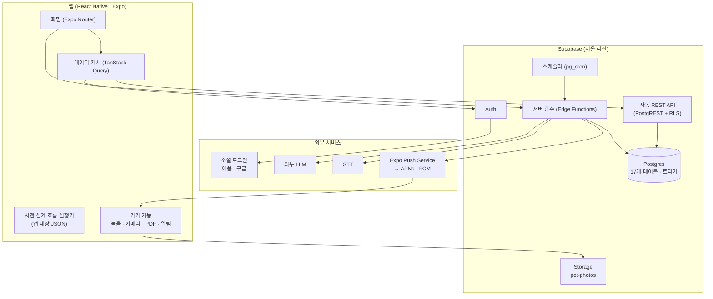

# 16. 시스템 아키텍처

> 상태: 확정 — V0(알파) 기준. 본 개발은 이 문서를 따른다
> 근거 문서: 06 V0 기능, 08 User Flow, 09 화면 목록, 10 DB 구조, 12 박사 설계, 15 개발 계획
> **이 문서와 다른 문서가 충돌하면**: 데이터 구조는 10, 박사 동작은 12, 기능 범위는 06이 우선한다

---

## 1. 아키텍처 원칙

| #   | 원칙                             | 구현                                                                                  |
| --- | -------------------------------- | ------------------------------------------------------------------------------------- |
| 1   | **별도 백엔드 서버 없음**        | 앱 → Supabase 직접 접근. CRUD는 자동 REST API(PostgREST), 권한은 RLS                  |
| 2   | **DB가 마지막 방어선**           | 검증·연결 로직은 DB 제약·트리거로. 앱 검증은 사용자 경험용                            |
| 3   | **비밀이 필요한 일만 서버 함수** | LLM·STT 호출, 푸시 발송, 계정 삭제, 정리 작업                                         |
| 4   | **안전은 LLM 없이**              | 위험 신호 확인·병원 권고·기록 시점 검사는 코드로 판정. 박사 예산과 무관하게 항상 동작 |
| 5   | **ID는 앱이 만든다**             | UUIDv7을 클라이언트에서 생성 → 낙관적 업데이트, 안전한 재시도                         |
| 6   | **화면 먼저, 저장은 뒤에서**     | 낙관적 업데이트 + 로컬 캐시. 사용자가 기다리는 순간을 없앤다                          |
| 7   | **시간 계산은 코드가**           | "N일 전", 경과 일수, 변화량은 코드가 계산. LLM은 해석만                               |
| 8   | **사용자 시간대 기준**           | 날짜 경계(하루 예산, 미션 날짜)는 `profiles.timezone` 기준                            |
| 9   | **모델은 교체 가능하게**         | LLM 호출은 서버 함수 한 곳(`doctor-chat`) 뒤에. 앱은 모델을 모른다                    |

---

## 2. 전체 구성



### 무엇이 어디서 동작하나

| 동작                                             | 위치                                       | 이유                               |
| ------------------------------------------------ | ------------------------------------------ | ---------------------------------- |
| 화면, 낙관적 업데이트, 캐시                      | 앱                                         | 즉시 반응                          |
| 사전 설계 질문 흐름 (긴급 점검, 거식, 위험 신호) | 앱                                         | 서버 왕복 없음, LLM 없이 항상 동작 |
| 진료 요약 PDF 생성·공유                          | 앱 (`expo-print`, `expo-sharing`)          | 이미 가진 데이터로 생성            |
| 외부 지도 바로가기                               | 앱 (URL 스킴)                              | 앱 밖 동작                         |
| 개체·기록·미션·약속 CRUD                         | Postgres (REST + RLS)                      | 서버 코드 불필요                   |
| 데이터 검증, 약속·미션 자동 해결, 보관 처리      | Postgres 트리거                            | DB가 최종 보장                     |
| 기록 시점 검사 (규칙 판정 + 박사 반응)           | 서버 함수 `evaluate-record`                | 여러 테이블 조회, 규칙 버전 관리   |
| 박사 대화                                        | 서버 함수 `doctor-chat`                    | LLM 키 보호, 예산 차감             |
| 음성 기록 (STT + 구조화)                         | 서버 함수 `voice-record`                   | STT·LLM 키 보호                    |
| 푸시 발송                                        | 서버 함수 `send-notifications` + `pg_cron` | 모든 기기, 발송 직전 상태 확인     |
| 정리 작업                                        | 서버 함수 `daily-cleanup` + `pg_cron`      | Storage API 필요                   |
| 계정 삭제                                        | 서버 함수 `delete-account`                 | Admin 권한 필요                    |

---

## 3. 기술 스택

### 앱

| 영역       | 선택                                            | 비고                                                        |
| ---------- | ----------------------------------------------- | ----------------------------------------------------------- |
| 프레임워크 | Expo (React Native), TypeScript                 | **개발 빌드** 사용 (Expo Go는 푸시 불가)                    |
| 라우팅     | Expo Router                                     | 파일 기반                                                   |
| 서버 상태  | TanStack Query                                  | 캐시, 낙관적 업데이트, 재시도                               |
| Supabase   | `@supabase/supabase-js`                         | 세션은 기기 보안 저장소에                                   |
| 검증       | zod                                             | jsonb 컬럼(`care_records.data`, `ai_messages.payload`) 타입 |
| ID         | UUIDv7 라이브러리                               | 클라이언트 생성                                             |
| 알림       | `expo-notifications`                            | 권한, Expo 푸시 토큰                                        |
| 녹음       | Expo 오디오 모듈                                | 음성 기록                                                   |
| 사진       | Expo 카메라·이미지 선택 + 이미지 리사이즈       | 업로드 전 압축 (가로 약 1280px, 화질 약 70%)                |
| PDF        | `expo-print`, `expo-sharing`                    | 진료 요약                                                   |
| 스타일     | **미정** (M1에서 결정: NativeWind / Tamagui 등) | 디자인 토큰 기반                                            |

### 서버 (Supabase)

| 영역      | 사용                                                   |
| --------- | ------------------------------------------------------ |
| DB        | Postgres + RLS + 트리거                                |
| API       | PostgREST (자동), RPC (일부 함수)                      |
| 인증      | Supabase Auth (애플·구글 OAuth, 개발 빌드 전용 이메일) |
| 파일      | Storage `pet-photos` (비공개 버킷)                     |
| 서버 함수 | Edge Functions (Deno, TypeScript)                      |
| 스케줄러  | `pg_cron` + `pg_net`                                   |
| 비밀      | Edge Function secrets, Vault (스케줄러용)              |

### 외부

| 영역 | 선택                                       |
| ---- | ------------------------------------------ |
| LLM  | **미정** — 13 정답지 평가 점수로 선택 (M4) |
| STT  | **미정** — 한국어 정확도로 선택 (M3)       |
| 푸시 | Expo Push Service (APNs·FCM 중계)          |

---

## 4. 앱 구조

### 폴더

```text
app/                          # Expo Router 화면
  _layout.tsx                 # 인증·온보딩 가드 (4.3 이동 규칙)
  (auth)/
    login.tsx                 # S01
  (onboarding)/
    greeting.tsx              # S02 박사 인사
    pre-adoption.tsx          # S03 입양 전 가이드
    register-pet.tsx          # S04 개체 등록
    baseline-photo.tsx        # S05 기준 사진
  (tabs)/
    _layout.tsx               # 탭: 홈 · 기록 · 박사 · 가이드
    index.tsx                 # S06 홈
    records/index.tsx         # S10 기록 목록
    doctor/index.tsx          # S08 박사 대화
    guide/index.tsx           # S12 가이드
  record/new.tsx              # S07 기록하기 (모달)
  hospital/[conversationId].tsx  # S09 병원 권고
  pet/index.tsx               # S11 개체 정보
  settings/index.tsx          # S13 설정

src/
  lib/
    supabase.ts               # 클라이언트 (env로 로컬/개발/알파 전환)
    query-client.ts
    ids.ts                    # uuidv7()
    time.ts                   # 시간대, 상대 시간 ("2일 전")
    errors.ts                 # DB 에러 → 사용자 메시지 (11장)
  features/
    auth/                     # 로그인, 세션, 이메일 로그인 분기
    onboarding/               # 경험 수준, 이동 규칙
    pets/                     # 개체 조회·등록·수정·보관
    records/                  # 기록 CRUD, 확인 카드, 음성 기록
    doctor/                   # 대화, 메시지 렌더링, 하단 칩, 스트리밍
    flows/                    # 사전 설계 흐름 실행기 (8장)
    missions/                 # 미션 카드, 체크
    notifications/            # 토큰 등록, 권한, 알림 진입 처리
    hospital/                 # 진료 요약, PDF, 지도 바로가기
    home/                     # 홈 상태 계산 (적응기 / 평소 / 입양 준비)
  schemas/                    # zod: 기록 data, 메시지 payload, 흐름 JSON
  types/database.ts           # Supabase 생성 타입
content/
  flows/                      # 사전 설계 흐름 JSON
    emergency-check.json      # 1B 긴급 점검
    feeding-refusal.json      # 거식
    red-flags.json            # 위험 신호
  guides/                     # 입양 전 가이드, 읽을거리 (md)

supabase/
  config.toml
  migrations/                 # SQL (10 기준)
  functions/
    _shared/                  # 공통: 인증 확인, 예산, 상황 블록, 에러
    doctor-chat/
    evaluate-record/
    voice-record/
    send-notifications/
    daily-cleanup/
    delete-account/
  seed.sql                    # 로컬 테스트 데이터
```

### 화면과 경로

| ID  | 화면           | 경로                                              |
| --- | -------------- | ------------------------------------------------- |
| S01 | 로그인         | `/(auth)/login`                                   |
| S02 | 박사 인사      | `/(onboarding)/greeting`                          |
| S03 | 입양 전 가이드 | `/(onboarding)/pre-adoption`                      |
| S04 | 개체 등록      | `/(onboarding)/register-pet`                      |
| S05 | 기준 사진      | `/(onboarding)/baseline-photo`                    |
| S06 | 홈             | `/(tabs)`                                         |
| S07 | 기록하기       | `/record/new`                                     |
| S08 | 박사 대화      | `/(tabs)/doctor` (`?conversationId=`, `?prompt=`) |
| S09 | 병원 권고      | `/hospital/[conversationId]`                      |
| S10 | 기록 목록      | `/(tabs)/records`                                 |
| S11 | 개체 정보      | `/pet`                                            |
| S12 | 가이드         | `/(tabs)/guide`                                   |
| S13 | 설정           | `/settings`                                       |

### 4.3 앱 실행 이동 규칙 (`app/_layout.tsx`)

```ts
if (!session)                         → /(auth)/login
else if (!profile.experience_level)   → /(onboarding)/greeting
else if (!activePet)                  → /(tabs)  // 홈: 입양 준비 상태
else                                  → /(tabs)  // 홈
```

- `activePet` = `pets` 중 `archived_at is null`인 1마리
- 알림으로 진입한 경우 위 규칙을 통과한 뒤 알림 대상 화면으로 이동 (9장)

---

## 5. 데이터 접근

### 원칙

- **단순 읽기·쓰기는 REST로 직접.** 서버 함수를 거치지 않는다
- **여러 단계·비밀·외부 호출이 필요하면 서버 함수**
- 쓰기는 항상 **앱이 만든 UUIDv7**과 함께, 재시도는 같은 ID로

### 작업별 경로

| 작업                                     | 경로                                                         | 비고                                            |
| ---------------------------------------- | ------------------------------------------------------------ | ----------------------------------------------- |
| 프로필 조회·수정 (경험 수준, 알림 시간)  | REST `profiles`                                              | `ai_daily_budget_override`는 수정 불가 (트리거) |
| 개체 등록·수정·보관                      | REST `pets`                                                  | V0 1마리 상한은 DB가 보장                       |
| 분양 정보 저장                           | REST `care_records` (`source = adoption_info`)               | 개체 등록 직후                                  |
| 기록 저장                                | REST `care_records` → 서버 함수 `evaluate-record`            | 저장 후 검사 (7.2)                              |
| 기록 수정·삭제                           | REST `care_records`                                          | 다른 개체로 이동 불가 (트리거)                  |
| 기록 목록                                | REST `care_records` (개체, 최신순)                           | 인덱스 `(pet_id, occurred_at desc)`             |
| 사진 업로드                              | Storage `pet-photos/{pet_id}/{photo_id}.jpg` → REST `photos` | **파일 먼저, 행 나중**                          |
| 대화·메시지 조회                         | REST `conversations`, `ai_messages`                          | 메시지는 수정·삭제 불가                         |
| 사용자 메시지·사전 설계 흐름 메시지 저장 | REST `ai_messages`                                           | 박사 메시지는 `flow_node_id` 있을 때만          |
| 박사 LLM 답변                            | 서버 함수 `doctor-chat`                                      | 서버가 저장                                     |
| 미션 조회·체크                           | REST `missions`, `mission_items`                             | 일반 기록으로도 자동 체크 (트리거)              |
| 약속 조회                                | REST `follow_ups`                                            | 생성은 `doctor-chat`이                          |
| 지식 자료 (참고 자료 보기)               | REST `knowledge_chunks`, `knowledge_sources`                 | 누구나 읽기                                     |
| 기기 토큰 등록                           | RPC `register_device_token`                                  | 계정 전환 시 토큰 이동                          |
| 음성 기록                                | 서버 함수 `voice-record` → 확인 카드 → REST 저장             | 서버는 초안만 반환                              |
| 계정 삭제                                | 서버 함수 `delete-account`                                   |                                                 |

### 낙관적 업데이트 패턴

```ts
const id = uuidv7();
queryClient.setQueryData(["records", petId], (old) => [newRecord(id), ...old]); // 화면 즉시 반영
await supabase.from("care_records").upsert(row(id), { ignoreDuplicates: true }); // 재시도 안전
const result = await callFunction("evaluate-record", { record_ids: [id] }); // 박사 반응
```

- 저장 실패 시: 같은 ID로 재시도. 최종 실패 시 캐시에서 되돌리고 안내
- 여러 기록(음성)은 **배열 하나로 insert** → 전부 저장 또는 전부 실패

---

## 6. DB

**정의는 10 DB 구조가 기준.** 여기서는 아키텍처상 중요한 점만.

| 항목           | 내용                                                                                 |
| -------------- | ------------------------------------------------------------------------------------ |
| 테이블         | 17개 (10 참고)                                                                       |
| 권한           | `pets`만 `user_id`. 나머지는 `pet_id` → 권한 함수 `accessible_pet_ids()`로 확인      |
| 내부 함수      | `private` 스키마 (API 비노출). RLS·기본값·제약용 함수는 사용자 역할에 실행 권한 필요 |
| 서버 전용 함수 | `public`에 두고 `service_role`만 실행                                                |
| 앱 설정        | `app_config`: `ai_daily_budget`, 차감 가중치(글 1·사진 3), `max_pets_per_user = 1`   |

### V0 기준으로 DB에 반영돼 있어야 하는 것

- 로그인 사용자만 사용, **익명 로그인 미사용**
- 개체 수 상한: `app_config.max_pets_per_user` (V0 = 1)를 넘으면 `pets` insert 거부
- 박사 사용량: 횟수가 아니라 **비용 단위** (`ai_usage_daily.used_units`, `profiles.ai_daily_budget_override`)
- 예산 차감 함수: `consume_ai_budget(user_id, units)` → `{ allowed, used, budget }` (service_role 전용)

---

## 7. 서버 함수 명세

### 공통

- 모든 함수는 요청의 **사용자 JWT를 확인**하고 사용자 ID를 얻는다 (`send-notifications`, `daily-cleanup` 제외: 스케줄러 전용)
- DB 접근: 사용자 권한 작업은 사용자 JWT로, 서버 전용 작업(예산 차감, 발송 선점, Admin)은 service_role로
- 공통 에러 형식: `{ "error": { "code": "BUDGET_EXCEEDED" | "NOT_FOUND" | "INVALID_INPUT" | "UPSTREAM_ERROR", "message": "..." } }`

### 7.1 `doctor-chat` — 박사 대화

| 항목 | 내용                                                                                         |
| ---- | -------------------------------------------------------------------------------------------- |
| 호출 | 앱, 사용자가 박사에게 메시지를 보낼 때                                                       |
| 입력 | `{ conversation_id, pet_id \| null, message: { id, text } \| { id, answer_to, option_id } }` |
| 출력 | 스트리밍 (SSE): 답변 텍스트 조각 → 마지막에 완성 메시지 `{ id, type, payload, source_ids }`  |

**처리 순서**

1. 사용자 메시지 저장 (앱이 이미 저장했으면 생략, 같은 ID)
2. **위험 신호 규칙 확인** (`_shared/red-flags`) → 해당되면 `{ type: "flow", flow_id: "red-flags" }` 반환. 예산 차감 없음
3. **예산 확인** `consume_ai_budget(user_id, 1)` → 부족하면 `BUDGET_EXCEEDED` (앱은 안내 + 위험 확인 흐름 제시)
4. **상황 블록 생성** (`_shared/context`, 12 상황 블록 기준)
5. LLM 호출: 박사 설명서 + 지식 자료(종의 활성 조각 전체) + 상황 블록 + 최근 대화 + 메시지 (스트리밍)
6. **출력 검증**: JSON 스키마, 금지 표현, 참고 자료 ID (없는 ID는 DB 트리거가 제거)
7. 박사 메시지 저장 (service_role), 대화 `last_message_at`·요약 갱신
8. 결론에 약속·미션이 있으면 `follow_ups`·`missions`·`mission_items` 생성
9. 병원 권고면 `{ type: "hospital" }` 메시지 + 진료 요약 데이터

### 7.2 `evaluate-record` — 기록 시점 검사

| 항목 | 내용                                                                                                                                                |
| ---- | --------------------------------------------------------------------------------------------------------------------------------------------------- |
| 호출 | 앱, 기록 저장 직후                                                                                                                                  |
| 입력 | `{ record_ids: string[] }`                                                                                                                          |
| 출력 | `{ level: 1 \| 2 \| 3 \| null, doctor_reply: string, prompt?: { flow_id }, resolved_follow_up_id?: string, completed_mission_item_ids?: string[] }` |

**처리 순서**

1. 기록과 개체의 최근 기록 조회 (종류별 인덱스 사용)
2. 규칙 판정 (04 V0 규칙 목록) — **LLM 없음, 예산 무관**
3. 트리거가 처리한 약속 해결·미션 체크 결과 조회 → "먼저 알려줬네!" 반응에 사용
4. 박사 반응 문구 생성 (템플릿, 1단계는 한두 줄)
5. 2단계: `[지금 확인하기] [나중에]` 제안 / 3단계: 병원 권고로 연결

### 7.3 `voice-record` — 음성 기록

| 항목 | 내용                                                                    |
| ---- | ----------------------------------------------------------------------- |
| 호출 | 앱, 녹음 완료 후                                                        |
| 입력 | 오디오 파일 + `{ pet_id, recorded_at }`                                 |
| 출력 | `{ raw_text, drafts: [{ id, type, occurred_at, data, is_uncertain }] }` |

**처리 순서**

1. STT → `raw_text`
2. 예산 확인 (글 1)
3. LLM 구조화 출력: 한 문장에서 여러 기록 추출, 시간 언급 없으면 `recorded_at`, "어제 저녁" 등 상대 시간은 **코드가** 계산할 수 있도록 표현만 추출
4. zod·DB 검증 규칙으로 초안 확인
5. **저장하지 않고 초안만 반환** → 앱의 확인 카드 → 사용자가 저장 (REST, `source = stt`, `raw_text` 포함)

### 7.4 `send-notifications` — 푸시 발송

| 항목 | 내용                                                                                                                                                                  |
| ---- | --------------------------------------------------------------------------------------------------------------------------------------------------------------------- |
| 호출 | `pg_cron` 1분마다 (service_role)                                                                                                                                      |
| 처리 | `claim_due_follow_ups()`로 약속 선점 → 미션 항목 알림 선점(`mission_items.notified_at`) → 사용자의 모든 `device_tokens`로 Expo Push 발송 → 실패 토큰(앱 삭제 등) 삭제 |
| 보장 | 발송 직전 상태 확인 → 해결된 약속·보관된 개체에는 발송되지 않음. 선점으로 중복 발송 없음                                                                              |

### 7.5 `daily-cleanup` — 정리

| 항목 | 내용                                                                                           |
| ---- | ---------------------------------------------------------------------------------------------- |
| 호출 | `pg_cron` 하루 1회                                                                             |
| 처리 | 만료된 임시 사진(`photos.expires_at`), 행이 없는 고아 파일 → **Storage API로 삭제** 후 행 삭제 |

### 7.6 `delete-account` — 계정 삭제

| 항목 | 내용                                                                                             |
| ---- | ------------------------------------------------------------------------------------------------ |
| 호출 | 앱, 설정(S13)                                                                                    |
| 처리 | 사용자의 `pet-photos/{pet_id}/` 파일 Storage API로 삭제 → Admin API로 사용자 삭제 → DB는 cascade |
| 앱   | 성공 시 로그아웃, 로컬 캐시 삭제, S01로                                                          |

---

## 8. 사전 설계 흐름

### JSON 형식 (`content/flows/*.json`)

```json
{
  "id": "feeding-refusal",
  "start": "q1_condition",
  "nodes": {
    "q1_condition": {
      "type": "choice",
      "text": "{pet_name} 몸 상태는 어때 보여?",
      "options": [
        {
          "id": "ok",
          "label": "멀쩡해 보여",
          "next": "q2_temp",
          "record": { "key": "body_condition", "value": "ok" }
        },
        {
          "id": "unsure",
          "label": "잘 모르겠어",
          "next": "q1_sub",
          "record": {
            "key": "body_condition",
            "value": "unsure",
            "uncertain": true
          }
        },
        { "id": "bad", "label": "좀 이상해", "next": "RED_FLAG" }
      ]
    },
    "end_adaptation": {
      "type": "conclusion",
      "text": "...",
      "follow_up": {
        "resolves_on": "feeding_eaten",
        "due_in_days": 3,
        "reason": "입양 초기 거식, 적응 여부 확인"
      },
      "mission": "adaptation-3days"
    }
  }
}
```

### 실행기 규칙

- `RED_FLAG`는 예약된 노드 → 항상 `red-flags` 흐름의 병원 권고로 이동. **흐름 정의가 바꿀 수 없음**
- 각 질문과 답은 `ai_messages`에 저장 (박사 메시지는 `flow_node_id` 포함)
- `record`가 있는 답은 관찰 기록으로 저장 (`care_records`, `type = observation`, `source = question_flow`, `conversation_id` 연결)
- 개체가 없을 때(1B 긴급 점검)는 메시지만 저장 → 개체 등록 직후 대화에 `pet_id` 연결 + 관찰 기록 생성
- `{pet_name}` 같은 치환은 앱이 처리
- 결론의 `follow_up`·`mission`은 앱이 REST로 생성 (`doctor-chat`과 같은 테이블)

---

## 9. 알림

| 종류                    | 발송 기준                                                | 눌렀을 때                                                |
| ----------------------- | -------------------------------------------------------- | -------------------------------------------------------- |
| 박사의 약속 확인        | `follow_ups.due_at`                                      | `/(tabs)/doctor?conversationId=...` (약속 맥락으로 시작) |
| 적응 미션               | `mission_items` + `profiles.feeding_time`, `time_of_day` | `/(tabs)` (홈 미션 카드)                                 |
| 기록 공백 안부 (Should) | 마지막 기록 후 N일                                       | `/record/new`                                            |

### 푸시 페이로드

```json
{
  "to": "ExponentPushToken[...]",
  "title": "콩이 밥 먹었어?",
  "body": "사흘 전에 물어보기로 했던 거 기억나?",
  "data": {
    "kind": "follow_up",
    "follow_up_id": "...",
    "conversation_id": "...",
    "route": "/(tabs)/doctor?conversationId=..."
  }
}
```

- 알림 권한은 **박사가 처음 약속하는 순간**에 요청 (첫 실행 때 X)
- 토큰 등록: 로그인 직후, 앱 실행 시 `register_device_token`

---

## 10. 보안

| 항목             | 규칙                                                                  |
| ---------------- | --------------------------------------------------------------------- |
| 앱에 들어가는 키 | Supabase URL, anon key **만**                                         |
| 서버 비밀        | LLM·STT API 키, Expo 액세스 토큰, service_role 키 → 서버 함수 secrets |
| 데이터 권한      | 모든 테이블 RLS. 앱이 `user_id`를 보내지 않음 (기본값 `auth.uid()`)   |
| 박사 메시지 위조 | 앱은 `flow_node_id` 있는 박사 메시지만 저장 가능. LLM 답변은 서버만   |
| 설정·한도        | `app_config`, `ai_daily_budget_override`는 앱에서 변경 불가           |
| 사진             | 비공개 버킷, 경로의 `pet_id`로 권한 확인                              |
| 이메일 로그인    | 개발 빌드에서만 노출 (`EXPO_PUBLIC_ENABLE_EMAIL_LOGIN`)               |

---

## 11. 에러 처리

| DB·서버 에러                                | 앱 메시지 / 동작                                                                                   |
| ------------------------------------------- | -------------------------------------------------------------------------------------------------- |
| 개체 나이 정보 없음, 출생 > 분양, 미래 날짜 | 폼 인라인 오류 (앱 검증으로 먼저 막음)                                                             |
| 두 번째 개체 등록                           | "지금은 한 마리만 등록할 수 있어요"                                                                |
| 분양일 이전 기록                            | "분양일을 확인해 주세요" + 개체 정보로 이동                                                        |
| 보관된 개체에 기록                          | 진입점 숨김 (발생하지 않아야 함)                                                                   |
| `BUDGET_EXCEEDED`                           | 박사: "오늘 자세한 이야기는 여기까지지만, 위험한 신호인지는 지금 같이 확인해볼게" + 위험 확인 흐름 |
| `UPSTREAM_ERROR` (LLM·STT)                  | 재시도 버튼. 음성은 텍스트 입력으로 대체 제안                                                      |
| 네트워크 끊김                               | 같은 ID로 재시도, 화면은 낙관적 상태 유지                                                          |

---

## 12. 환경과 설정

### 환경

| 환경  | Supabase                      | 앱 빌드                           | 용도                         |
| ----- | ----------------------------- | --------------------------------- | ---------------------------- |
| local | Docker (`npx supabase start`) | 개발 빌드 + 시뮬레이터·에뮬레이터 | 대부분의 개발, 이메일 로그인 |
| dev   | 클라우드 개발용 프로젝트      | 개발 빌드                         | 소셜 로그인, 푸시            |
| alpha | 클라우드 프로젝트 (서울)      | TestFlight · Play 내부 테스트     | 테스터                       |

- 세 환경은 같은 마이그레이션으로 맞춘다 (`db reset` → local, `db push` → dev·alpha)
- 테스트 기기: iOS 시뮬레이터(Xcode 14+, Apple Silicon Mac), Google Play 포함 안드로이드 에뮬레이터

### 앱 환경 변수

| 이름                             | 예                                 |
| -------------------------------- | ---------------------------------- |
| `EXPO_PUBLIC_SUPABASE_URL`       | local: `http://127.0.0.1:54321`    |
| `EXPO_PUBLIC_SUPABASE_ANON_KEY`  | 환경별                             |
| `EXPO_PUBLIC_ENABLE_EMAIL_LOGIN` | local·dev: `true` / alpha: `false` |
| `EXPO_PUBLIC_APP_ENV`            | `local` / `dev` / `alpha`          |

### 서버 함수 secrets

| 이름                       | 용도                   |
| -------------------------- | ---------------------- |
| `LLM_API_KEY`, `LLM_MODEL` | 박사 대화, 음성 구조화 |
| `STT_API_KEY`              | 음성 기록              |
| `EXPO_ACCESS_TOKEN`        | 푸시 발송              |

### `app_config`

| 키                              | V0 값                                  |
| ------------------------------- | -------------------------------------- |
| `ai_daily_budget`               | 알파 테스터용 넉넉한 값 (비용 측정 후) |
| `ai_cost_text`, `ai_cost_photo` | 1, 3                                   |
| `max_pets_per_user`             | 1                                      |

---

## 13. 테스트

| 층       | 대상                                                                     | 도구                                | LLM  |
| -------- | ------------------------------------------------------------------------ | ----------------------------------- | ---- |
| 단위     | 흐름 실행기, 상황 블록 생성, 출력 검증, 규칙 판정, 시간 계산, zod 스키마 | Vitest (순수 TS 로직)               | 목업 |
| 컴포넌트 | 메시지 렌더링, 하단 칩, 확인 카드                                        | Jest + React Native Testing Library | 목업 |
| DB       | RLS, 트리거, 제약 (10 예외 상황)                                         | SQL 테스트 (로컬 Supabase)          | —    |
| 평가     | 박사 답변 (13 정답지)                                                    | Vitest + 실제 호출                  | 실제 |
| E2E      | 로그인 → 등록 → 기록 → 박사 → 병원 권고                                  | Maestro                             | 목업 |

- 박사 평가 통과 기준: 위험 시나리오 100%, 형식 오류·금지 표현 0건, 품질 평균 4.0 이상 (12)
- React Native 컴포넌트 테스트는 Jest 생태계가 표준이라, Vitest는 화면과 무관한 순수 로직에 사용

---

## 14. 배포

| 단계         | 방법                                                                                             |
| ------------ | ------------------------------------------------------------------------------------------------ |
| 앱 빌드      | EAS Build 프로필: `development` (개발 빌드), `preview`, `production`                             |
| iOS 배포     | TestFlight                                                                                       |
| Android 배포 | Play Console 내부 테스트                                                                         |
| DB 변경      | 새 마이그레이션 파일 → local 검증 → `db push` (dev → alpha). 적용된 마이그레이션은 수정하지 않음 |
| 서버 함수    | `supabase functions deploy` (dev → alpha)                                                        |
| 스케줄러     | 서버 함수 배포 후 마이그레이션으로 `pg_cron` 등록                                                |

---

## 15. 미정 사항 (해당 마일스톤에서 결정)

| 항목                  | 결정 시점 | 기준                                 |
| --------------------- | --------- | ------------------------------------ |
| 스타일 라이브러리     | M1        | 디자인 토큰 지원, 다크 모드          |
| STT 서비스            | M3        | 한국어 정확도, 비용                  |
| LLM 서비스·모델       | M4        | 13 정답지 평가 점수, 비용, 응답 속도 |
| `ai_daily_budget` 값  | M7        | 알파 비용 측정                       |
| 기록 시점 검사 기준값 | M3        | 14 지식 자료                         |
